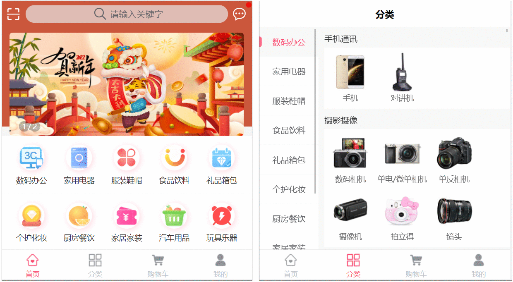
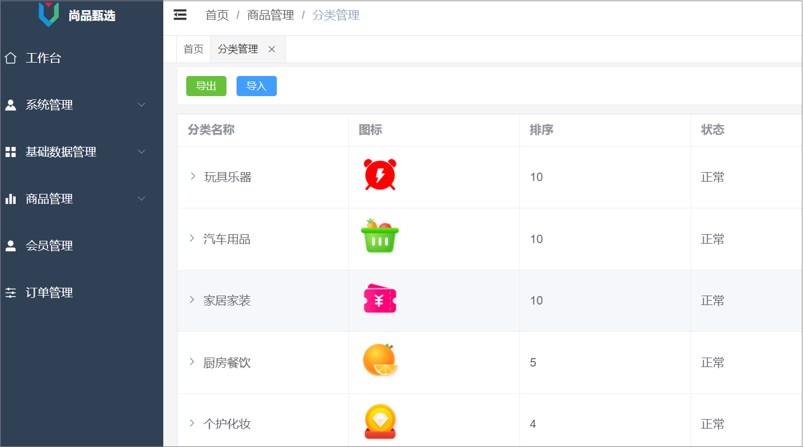
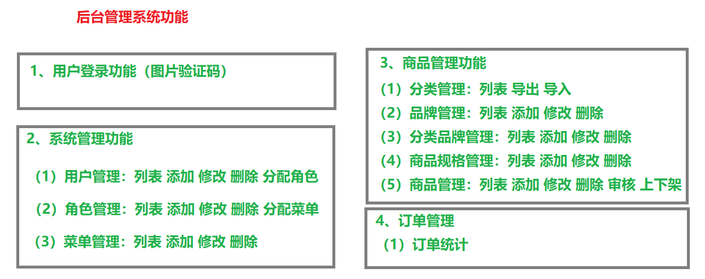
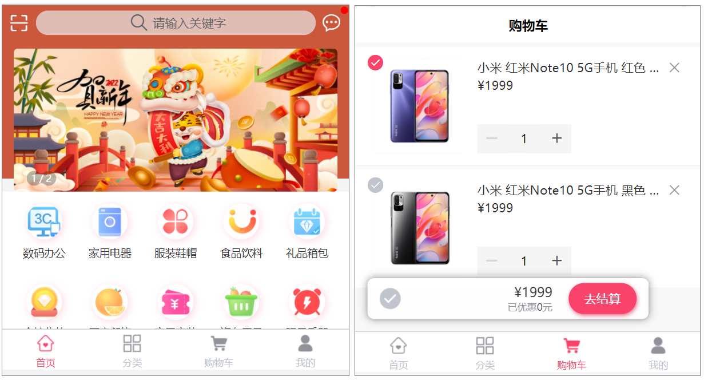
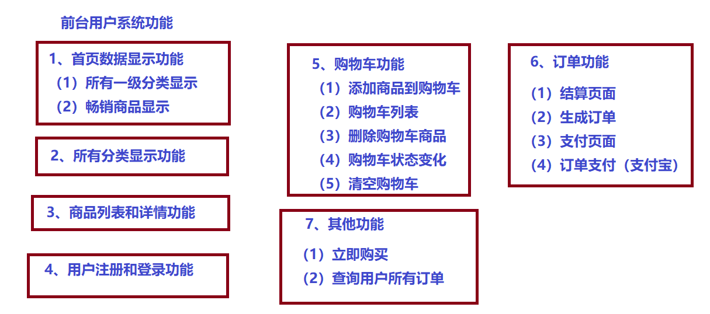
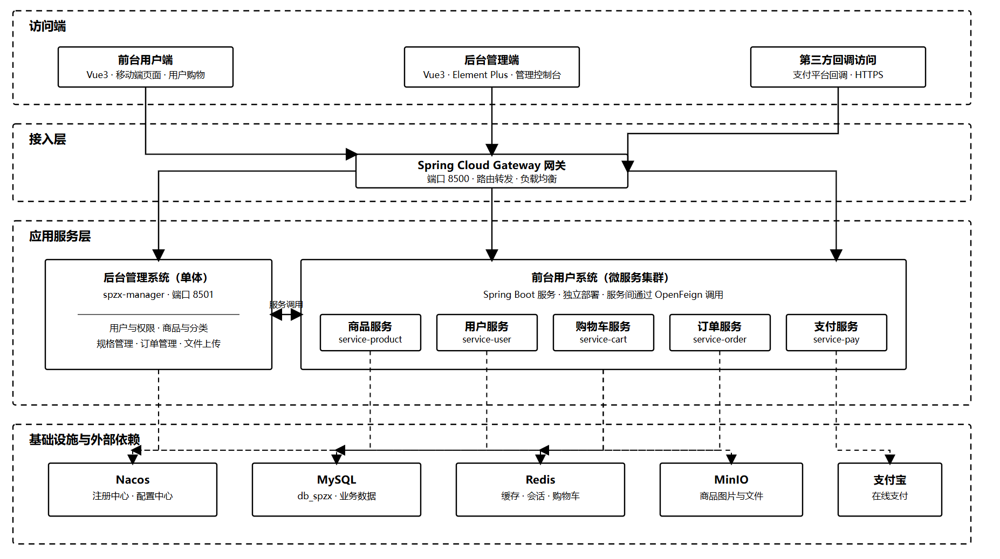
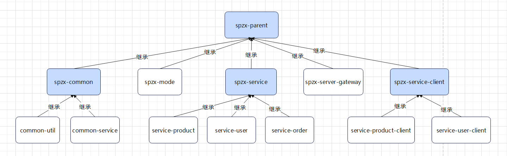
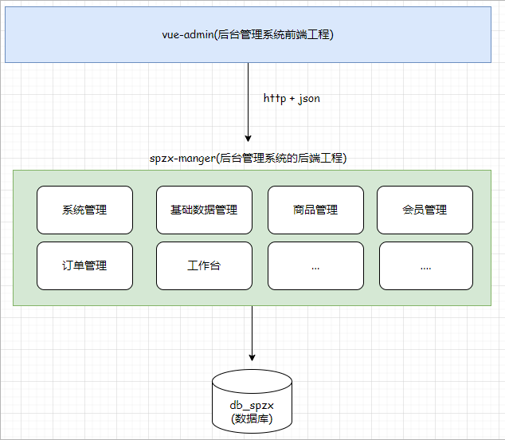
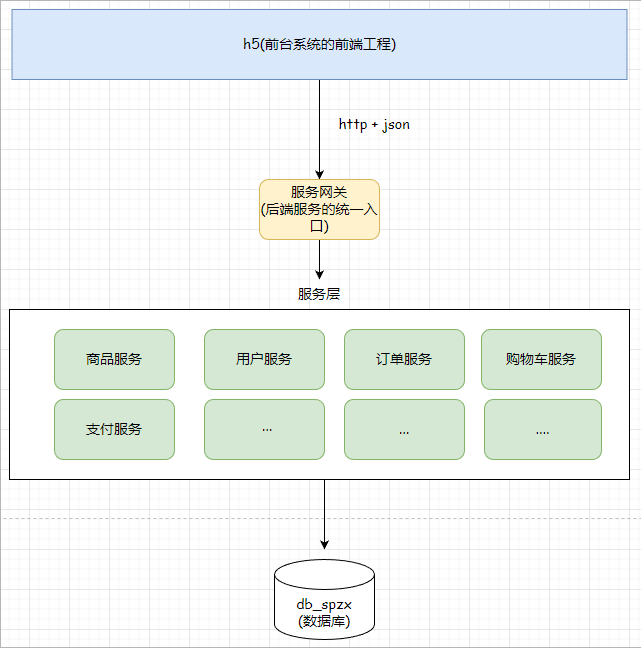

# SpringBoot-SpringCloud--Shangpin-Selection

## 项目简介

商品精选系统是一个面向商品展示与在线交易场景的 B2C 电商系统，采用前后端分离的开发模式。系统围绕“商品浏览、用户管理、购物车、订单与支付”构建完整的业务闭环，同时提供后台管理能力，用于维护平台运行所需的商品、分类、规格、用户和订单等基础数据。

项目由两套相互配合的应用组成：

- **后台管理系统**：面向平台管理员，负责基础数据维护、商品运营和订单管理。后台后端采用单体架构，便于集中实现管理类功能和统一维护业务数据。
- **前台用户系统**：面向普通用户，提供商品浏览、注册登录、购物车、提交订单和支付等功能。前台后端按照业务领域拆分为多个微服务，便于各模块独立开发、部署和扩展。

整个系统采用统一网关对外提供访问入口。用户端和管理端的请求先进入网关，再根据访问路径转发到对应的管理模块或业务微服务；微服务通过注册中心完成服务发现，并共同使用数据库、缓存和文件存储等基础设施。这样既保留了后台管理系统的实现简洁性，也使用户交易链路具备清晰的服务边界。

### 项目使用技术栈

**后端：** Spring Boot、Spring Cloud Alibaba、Spring Cloud Gateway、Nacos、MyBatis、MySQL、Redis、EasyExcel、MinIO、支付宝支付等

**前端：** Vue 3、Vue Router、Pinia、Vite、Element Plus、ECharts、Axios、Node.js、NPM

### 项目前后台演示

## 项目功能

### 业务功能介绍

- **后台管理系统功能**
  
平台管理员使用后台管理系统维护平台的基础数据和交易数据。通过登录和权限控制后，管理员可以管理商品分类、商品信息、商品规格、用户信息及订单信息，并通过数据看板了解平台运行情况。后台管理功能为前台用户提供稳定、完整的商品和交易数据。

- **前台用户系统功能**

 前台用户系统负责承载用户的主要购物流程，包括首页与分类展示、商品查询、用户注册登录、商品详情查看、购物车管理、订单提交和订单支付等。用户在前台完成的操作会通过网关进入对应的用户、商品、购物车、订单或支付服务。

 

### 系统架构介绍

系统整体采用“前后端分离 + 统一网关 + 分层服务”的架构。前端应用负责页面展示和交互，后端负责业务处理与数据持久化，网关负责统一接入和请求路由，Nacos 负责微服务的注册发现与配置管理，MySQL、Redis 和 MinIO 分别承担业务数据、缓存数据以及图片和文件的存储。支付服务通过支付宝完成支付请求和异步回调。

下面的总体部署架构图展示了各个应用、服务、基础设施和外部平台之间的部署关系与调用方向。

#### 项目模块关系

后端项目以 Maven 多模块方式组织，公共模块、数据模型、管理端、网关、业务服务和服务客户端分别承担不同职责。公共模块提供通用工具和公共业务能力，服务客户端用于封装跨服务调用所需的接口，减少业务服务之间的直接耦合。

#### 后台管理系统

后台管理系统后端采用单体架构，用户、权限、商品、分类、规格和订单等管理功能集中在 `spzx-manager` 模块中。该方式适合管理端功能集中、业务边界相对稳定的场景，能够降低管理端部署和维护的复杂度。

#### 前台用户系统

前台用户系统后端采用微服务架构，将用户、商品、购物车、订单和支付拆分为独立服务，并由网关统一对外提供访问入口。各服务可以按照自身业务压力独立扩展，服务之间通过接口和服务发现机制协作：商品服务负责商品数据，用户服务负责账户相关业务，购物车服务负责购物车数据，订单服务负责交易单据，支付服务负责支付请求及支付结果处理。

### 系统运行协作

以用户下单为例，前端首先通过网关访问商品、用户、购物车和订单等服务；订单服务在创建订单时读取商品和用户信息，并将订单及明细保存到 MySQL。Redis 用于缓存和临时业务数据，商品图片等文件由 MinIO 保存。用户发起支付后，支付服务调用支付宝接口，支付宝再通过回调地址通知系统更新支付状态。后台管理员可以通过管理端查询和维护这些业务数据。

因此，系统的核心业务链路可以概括为：

`用户端/管理端 -> 网关 -> 管理端或业务微服务 -> MySQL/Redis/MinIO/第三方支付平台`

